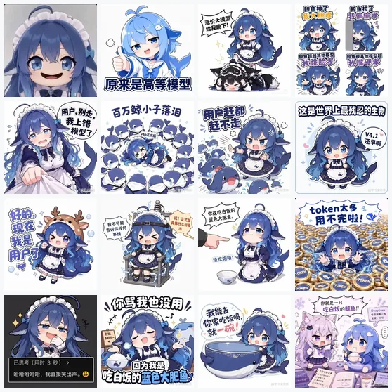

# Whale Companion

> A whale-girl companion for DeepSeek Harness: your account balance at a glance, with a face that changes.

[中文](README.md) · [Changelog](CHANGELOG.md) · [Contributing](CONTRIBUTING.md)




## Highlights

- **Always there** — rendered in Harness' frame-wide `shell.overlay` layer. She survives session switches, the welcome screen and every panel; the layer is click-through, so she only ever occupies her corner.
- **Live balance** — reads the DeepSeek account wallets every 30 seconds, refreshes when the page becomes visible again, and on click.
- **Large** — a 204px portrait above a 38px balance figure, in a 234px-wide vertical card that grows upward instead of crowding the composer.
- **Sixteen expressions** — click for the next one, `Shift + click` for a random one; auto-in-order, auto-random or manual rotation, paused while you hover.
- **No dependencies, no build step** — plain JavaScript, images embedded as WebP data URIs, works offline.
- **No credentials** — the plugin never reads or stores a token; the balance request is made by Harness' own account service.

## Layout

```
        ┌──────────────────┐
        │                  │   204 × 204 rounded portrait
        │     whale-chan    │   click: next · shift+click: random
        │                  │
        └──────────────────┘
        ┌──────────────────┐
        │ Balance           │   23px label
        │ ¥0.00             │   38px figure
        │ + bonus ¥4.65     │   22px green (only when there is bonus credit)
        │ ‹  auto · order › │   22px controls (brighten on hover)
        └──────────────────┘
```

- Recharge funds and bonus credit are separate wallets, shown the same way the official account page does; only positive bonus credit is listed.
- Signed out (for example with only an API key): "sign in to see the balance".
- A failed read keeps the last amount and dims the card instead of flashing zero.
- Amounts longer than nine characters step down one size so they never overflow.

## Install

Requires DeepSeek Harness with the account feature available (the desktop app on Windows/macOS, or the Web UI).

**1. Through the UI (recommended)**

1. Download `whale-companion-1.3.0.zip` from [Releases](../../releases) and unzip it to a stable folder;
2. Open **Plugins → Add plugin** (or the arrow → **Install a third-party plugin**);
3. Paste the folder's absolute path, or this repository's Git URL, accept the trust prompt, install;
4. Refresh the page if nothing changed.

**2. Ask the agent**

> Install the local plugin bundle at `C:\Users\you\Documents\whale-companion`

The agent calls `plugin_manager`'s `install_bundle`; `application: applied` means it is live.

**3. npm / tarball**

```bash
pnpm add /path/to/whale-companion-1.3.0.tgz
```

Or rename the package to your own scope, publish it, and let friends install it by package name.

**Uninstall**: Settings → Plugins → disable or remove "Whale companion", or run `remove_bundle` for `@local/whale-companion`.

## Usage

| Action | Result |
| --- | --- |
| Left click the portrait | Next expression (restarts the auto timer) |
| `Shift` + click | Random expression |
| Hover the card | `‹` `›` and the mode button appear; auto rotation pauses |
| Click the mode button | auto · in order (60s) → auto · random → manual |
| Click the balance figure | Refresh now |

## About the balance

The balance comes from the signed-in DeepSeek account and has two wallets:

- **Recharge funds**: the main line, formatted to two decimals per currency;
- **Bonus credit**: the green `+ bonus` line, only when a positive bonus exists.

Neither one is "this session's spend"; use Harness' own usage indicator for that.

## Artwork and rights

All sixteen portraits come from the public fan pack [deepseek-chan-meme-pack](https://github.com/the-beating-light-of-the-nail/deepseek-chan-meme-pack) (GengJing):

- Rule: every **square** preview is eligible; a **non-square** preview joins only when its longer-to-shorter ratio is ≤ 1.2, center-cropped.
- Included: `007 010 022 035 037 040 044 050 052 070 071 077 081 083 085 123`;
- Excluded by ratio: `056` (1.40), `058` (1.33), `087` (1.40), `097` (1.33).

The character 「蓝色大肥鱼 / 鲸鱼娘 / DeepSeek娘」 and the original drawings belong to their creators. This plugin is a personal, non-commercial fan project and claims no rights over the art; commercial use needs the original authors' permission. Full notice and takedown route: [NOTICE.md](NOTICE.md).

## FAQ

**Why do I only see ¥0.00 plus a bonus?**
The recharge wallet really is at zero; bonus credit is a separate wallet, exactly as the official account page shows it.

**Why is there no whale?**
Check that the plugin is enabled and the page was refreshed. Without a signed-in account the widget still renders, showing the sign-in hint instead of a figure.

**Does it upload my balance or credentials?**
No. The request goes through Harness' account service; the plugin only receives amounts and currencies, never a token, and reports nothing anywhere.

**Can I use my own images?**
Yes — edit the `ARTS` data URIs at the top of `client.js`. Square, at least 256px, compressed WebP works best.

**Does it get in the way?**
It occupies a 234 × ~400 strip in the bottom-right corner and sits below modals; an open right sidebar can be partly covered at its bottom edge.

## Development

```text
whale-companion/
├─ index.js            # Host half: empty apply; all rendering is on the client
├─ client.js           # Client half: UI, rotation, balance reads, embedded images
├─ cordis.patch.yml    # loader row inserted by the bundle
├─ assets/             # plugin icon and the sixteen-tile overview
├─ locale/             # Plugin Manager title and description
├─ docs/               # release copy and repo setup notes (not installed)
└─ package.json        # dsh.bundle / dsh.client declarations
```

- No build step. After editing `client.js`, reinstall the bundle (`remove_bundle` → `install_bundle`) and refresh; client bundles are cached per loader row.
- Only theme tokens (`--dsw-alias-*`) and plain React; no Harness Client packages are imported.
- See [CONTRIBUTING.md](CONTRIBUTING.md).

## Changelog

See [CHANGELOG.md](CHANGELOG.md). Latest: **1.3.0** — 1.5× UI, 2× type, sixteen expressions, rounded-square portrait.

## License

- Code: [MIT](LICENSE)
- Artwork: original creators, non-commercial fan use, **not covered by MIT** (see [NOTICE.md](NOTICE.md))

---

<sub>Community plugin, not affiliated with DeepSeek. Harness plugin mechanics are documented by the Harness project itself.</sub>
